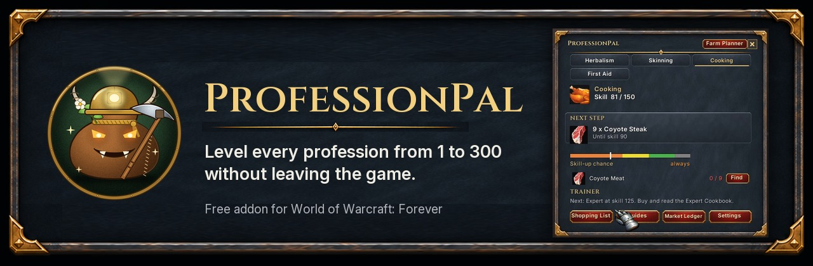
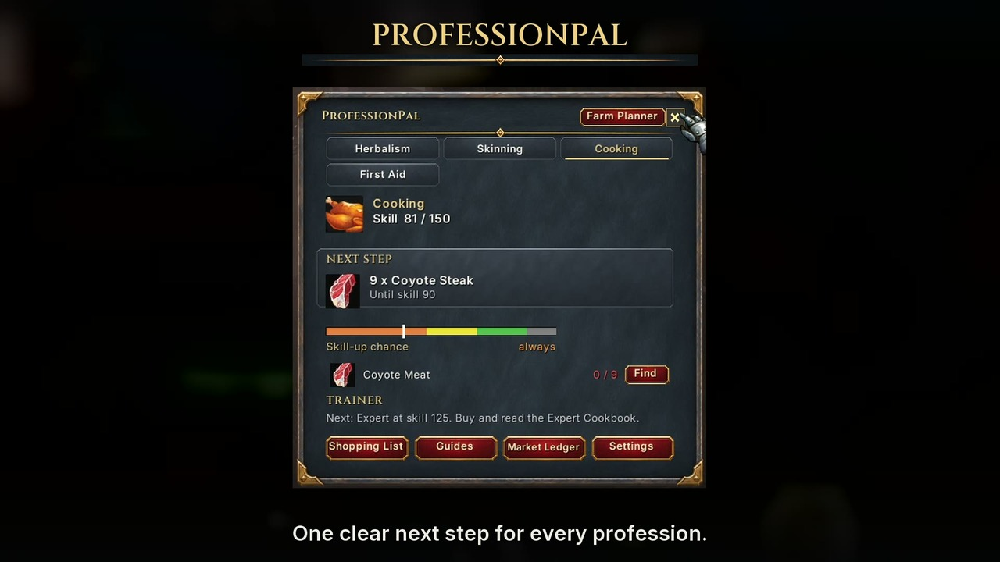
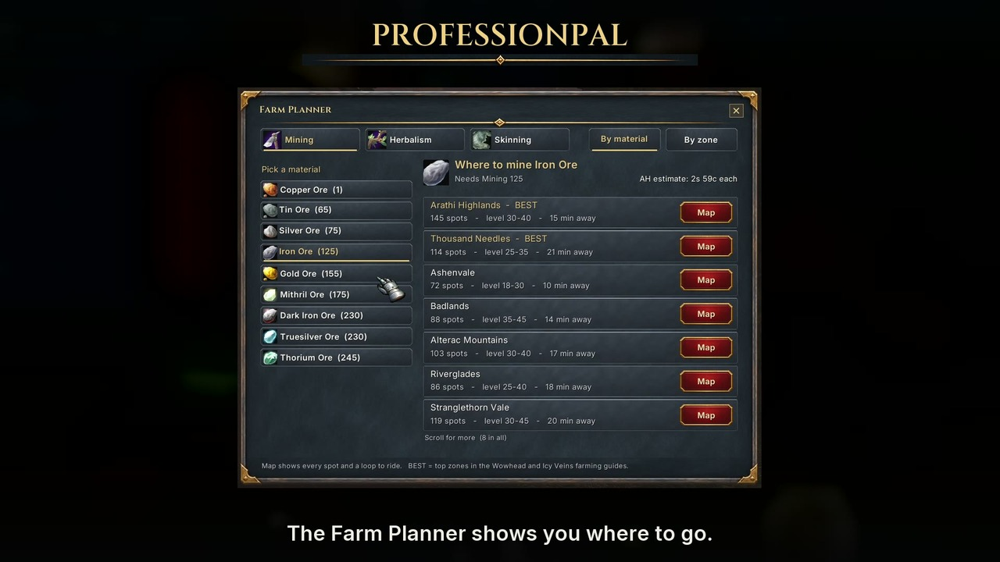
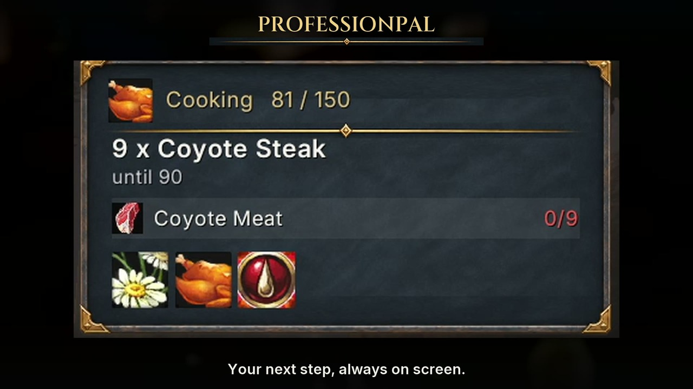
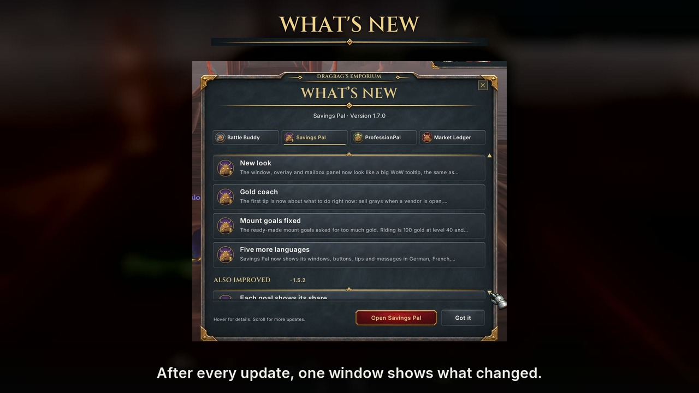

# ProfessionPal

**[Get it on CurseForge](https://www.curseforge.com/wow/addons/professionpal)** · [Download the zip](https://github.com/Yungslaya/ProfessionPal/releases/latest/download/ProfessionPal.zip) · [All changes](CHANGELOG.md)

**Always know your next profession step**

ProfessionPal reads your skill and your bags and tells you the one thing to do next, so you never need a guide open on another screen.

**[Watch the video on YouTube](https://youtu.be/2W8BDpfz9jg)**

## At a glance

- All 12 professions, skill 1 to 300, built for WoW Forever
- One line tells you what to make or gather next
- Skill-up chance for the step, with a bar showing orange, yellow, green and gray
- Farm Planner: every ore, herb and leather spot, with one loop to ride
- A small tracker keeps your next step on screen
- Shopping list to your next training, counting bags and bank
- Crafted gear picks for your class
- Type **/prof** to start

## Farm Planner

Pick a material or a zone and see where to go. Click **Map** and the world map shows every known spot and one loop to ride. The pin hops to the next spot when you get there.

Spots are places a node can spawn. It may not be up when you get there.

## Your next step, always on screen

The tracker shows what to make or gather, what you still need, and buttons for your profession spells.

## Gathering HUD

Press one key and your minimap moves over your character, big and see-through, so ore and herb dots show up around you while you ride. Press it again to put it back. Set the key in Key Bindings > AddOns > ProfessionPal, or type **/prof hud**.

## New: one look, and a What's new window

Every window now has the same stone frame, gold corners and clean text as our other addons. After an update, one window shows what changed, with a tab for each of our addons you have. Type **/prof news** to see it again.

## Works great with

- **[Market Ledger](https://www.curseforge.com/wow/addons/market-ledger)**: prices your bags at the Auction House, keeps the materials your guide needs, and adds a cost to your shopping list.
- **Shortest Path Forever** by cjber: road routes with boats and flights for the farm maps.
- **TomTom**: arrows to trainers.

ProfessionPal works fine without any of them.

## Languages

English, German, French, Spanish, Russian and Simplified Chinese. The addon switches by itself to match your game.

Only English has been tested in the game. The other languages are new and may have mistakes or parts still in English. If something looks wrong in your language, please post it in the comments.

## Commands

- **/prof** opens the guide.
- **/prof farm** opens the Farm Planner.
- **/prof news** shows what changed.
- **/prof starter** shows the simple starting settings. **/prof restore** puts your old settings back.

The skill-up chance uses the classic formula and Wowhead's recipe colors, so treat it as a close guess. Ore and herb spots are from Wowhead's WoW: Forever database. Guides are built from Icy Veins and Wowhead.

## More from Dragbag's Emporium

Four free addons with one shared look. Use one, or all four.

- **[Battle Buddy](https://www.curseforge.com/wow/addons/dbagsalerts)**: your next spell, timers and reminders, for all nine classes.
- **[Market Ledger](https://www.curseforge.com/wow/addons/market-ledger)**: what to sell, vendor and keep, right at the Auction House.
- **[Savings Pal](https://www.curseforge.com/wow/addons/drags-hedge-fund)**: sets gold aside for your mount every time you earn.

## What's new

- **1.6.0:** New look for every window and the tracker, button text that fits, and a What's new window after updates. Fully restart WoW after updating.
- **1.5.2:** One herb/ore label instead of two; the label over your head says In reach, Move closer or the skill you need. Type `/reload` after updating.
- **1.5.1:** Floating icon over herbs and ore (turns on WoW's Interact Key, so herb and ore reminders work), and farm zones follow your faction. Type `/reload` after updating.
- **1.5.0:** New look, skill-up chance and skill bar, shopping list cost, five more languages. Fully restart WoW after updating.
- **1.4.4:** The minimap checkbox in Settings follows `/prof minimap`. Type `/reload` after updating.

[All changes](CHANGELOG.md)

## Install

1. Easiest: install **ProfessionPal** from [CurseForge](https://www.curseforge.com/wow/addons/professionpal) with the CurseForge app.
2. WowUp: Get Addons, Install from URL, and paste `https://github.com/Yungslaya/ProfessionPal`.
3. By hand: [download the zip](https://github.com/Yungslaya/ProfessionPal/releases/latest/download/ProfessionPal.zip), unzip it, and put the `ProfessionPal` folder in `World of Warcraft\_forever_\Interface\AddOns`.

Fully restart WoW after installing.

## More details

Open the full guide

### What it does

- **One next step.** "Make 25 × Bronze Warhammer" or "Mine Tin and Silver in Hillsbrad". It updates the moment you skill up.
- **Have / need for every material,** counted across your bags and bank. Green when you have enough.
- **Trainers on the map.** It knows when you're about to cap, which trainer teaches your next rank, and drops a map pin (or a TomTom arrow).
- **Shopping list** for everything until your next training.
- **Gear For You.** Ranks the gear your profession can craft for your class and role, slot by slot, against what you're wearing.
- **On-screen tracker.** A small box that stays up, with Find Minerals, Find Herbs and Smelting buttons. Movable, and it hides in combat.
- **Import any guide.** Copy a guide page in your browser (Ctrl+A, Ctrl+C), click **Guides** and paste it. You get the same step view, counts and trainers. Switch back to the built-in guide any time.
- **Auto-learn (optional).** At a trainer you opened, it learns the recipes the guide needs, up to a gold limit you set. Off until you turn it on.

Covers Mining, Herbalism, Skinning, Fishing, Blacksmithing, Alchemy, Leatherworking, Tailoring, Engineering, Enchanting, Cooking and First Aid.

Type `/prof` or click the minimap button to open it. `/prof starter` shows the simple starting settings, and `/prof restore` puts your old settings back.

### Show me where to go

Every zone in the guide has a **Map** button. Click it and the world map opens on that zone with:

- a dot for every known ore or herb spot, and one loop to ride through them
- a pin on the closest flight point you know, or on the nearest spot if you are already in the zone
- a bar with the route buttons

When you reach the pin, it hops to the next spot.

- **Next** skips a spot that has nothing.
- **Rejoin** picks the loop back up near you, in the direction you were going.
- **Reverse** turns you around on the loop.
- **Clear** on the map, or **Stop route** in the guide window, ends it.

If another guide or quest route takes over, your loop waits on the map. Click **Resume** to get it back.

Saved minimap marks show places a node *can* spawn, good to about 40 yards. A node may not be up when you get there.

**Optional:** with [Shortest Path Forever](https://github.com/cjber/shortest-path-forever) by cjber installed, you get a road route with boats and flights. Without it you get the game's map pin. None of its code is included.

### Farm Planner

Type `/prof farm` or click **Farm Planner** at the top of the window. Pick **Mining**, **Herbalism** or **Skinning** at the top, then:

- **By material:** pick something like Iron Ore or Thick Leather and see every zone that has it.
- **By zone:** pick a zone and choose what to farm there, including **All ore you can mine**, **All herbs you can pick** and **All leather you can skin**.

All three work the same way. Each zone shows its spots (for leather: the beasts you can skin), the zone level and how far away it is. A gold **BEST** marks the top 1 or 2 zones for each ore, herb and leather, picked from Wowhead's ranked farming guides and Icy Veins' WoW: Forever routes, and they are listed first. **Map** opens the map with every spot and a loop to ride.

Leather spots are where skinnable beasts of the right level spawn, from the Wowhead WoW: Forever database. Travel times come from [Shortest Path Forever](https://github.com/cjber/shortest-path-forever) when you have it installed.

### Gathering HUD

Press one key and your minimap moves over your character, big and see-through, so ore and herb dots show up around you while you ride. Press it again to put it back.

- Clicks pass straight through to the world.
- Point at a yellow ore or herb dot to see its name. Hold **Alt** if you want to click the map itself.
- A small **farming counter** under the HUD shows what you're gathering: bag count, full stacks, and how many you picked up this run. Drag it anywhere.
- It turns with you and fades out in combat. Size, see-through and height are in Settings.
- Set the key in **Key Bindings > AddOns > ProfessionPal**, or type `/prof hud`.

It only moves the game's own minimap. It never moves you or gathers for you.

### Gathering reminders

Learn Mining, Herbalism or Skinning. When you hover a node, look at it with the Interact Key, or target a skinnable corpse, a small icon shows what it is and whether you can reach it and have the skill.

- `/prof harvest test` shows a preview.
- `/prof harvest unlock` lets you drag it. `/prof harvest lock` locks it again.
- `/prof harvest off` / `on` turns it off or on. There is also a box in Settings.
- `/prof harvest guide on` / `off` turns the node arrow on or off. It follows the dot you point at on the minimap or HUD. It starts off.
- `/prof harvest skip` skips the current spot for two minutes.

It only reads what the game shows you. It never gathers or moves you.

### Works with Market Ledger

**[Market Ledger](https://github.com/Yungslaya/MarketLedger)** is a separate addon. It prices your bags at the Auction House and tells you what to auction, vendor, craft or keep. With both installed:

- Market Ledger won't sell materials your guide still needs.
- Its **Farm** tab uses ProfessionPal's maps.
- The **Market Ledger** button in the guide window opens it.

ProfessionPal works fine without it.

### Is it safe?

Yes. It reads your skill and bags and shows you text. It never crafts, gathers, moves you or buys anything by itself. The spell buttons and **Craft it** work like your action bar: one click, one cast. The only thing that can spend gold is auto-learn, and it starts off.

### Found a problem?

Send a screenshot and your profession skill on the [issues page](https://github.com/Yungslaya/ProfessionPal/issues). To see error messages in game, type `/console scriptErrors 1` once.

Crafting steps above skill 225 come from Wowhead's planner and haven't all been checked in game yet. Gear picks are ranked by item stats.

### Credits

- Guides built from the [Icy Veins WoW: Forever profession guides](https://www.icy-veins.com/wow-forever/professions-overview) and the [Wowhead WoW: Forever](https://www.wowhead.com/forever/guides/professions) item database.
- Ore, herb and beast spots from the [Wowhead WoW: Forever database](https://www.wowhead.com/forever).
- Best farming zones from Wowhead's [mining](https://www.wowhead.com/classic/guide/classic-mining-best-farming-basics-early-ores) and herbalism ([1-150](https://www.wowhead.com/classic/guide/classic-herbalism-best-farming-basics-early-herbs), [150-300](https://www.wowhead.com/classic/guide/classic-herbalism-best-farming-high-end-herbs)) and [leather](https://www.wowhead.com/classic/guide/classic-leather-farming-early-leather) farming guides and the [Icy Veins WoW: Forever mining](https://www.icy-veins.com/wow-forever/mining-leveling-guide) and [herbalism](https://www.icy-veins.com/wow-forever/herbalism-leveling-guide) leveling guides, plus the [Icy Veins WoW: Forever skinning guide](https://www.icy-veins.com/wow-forever/skinning-leveling-guide).
- Road routes by [Shortest Path Forever](https://github.com/cjber/shortest-path-forever) by cjber (optional).

